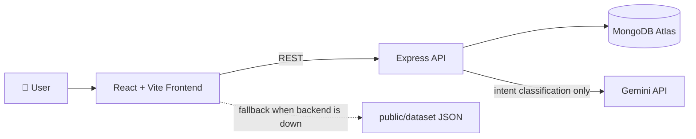
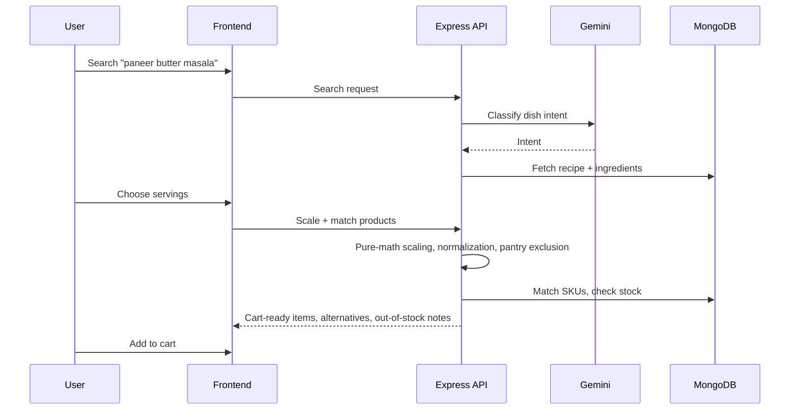

<div align="center">

# 🍳 CookCart-AI

### From "What should I cook?" to a ready grocery cart — in one search.

Discover recipes, scale ingredients to your serving size, and add the exact products you need to your cart. Powered by AI-assisted dish search, backed by deterministic math.


</div>

---

## 📖 Table of Contents

- [About](#-about)
- [Key Features](#-key-features)
- [Tech Stack](#-tech-stack)
- [Architecture](#-architecture)
- [Getting Started](#-getting-started)
- [Environment Variables](#-environment-variables)
- [Seed the Database](#-seed-the-database)
- [Running Tests](#-running-tests)
- [Project Structure](#-project-structure)
- [Design Decisions](#-design-decisions)
- [Roadmap](#-roadmap)
- [Contributing](#-contributing)
- [Author](#-author)

---

## 🌟 About

**CookCart-AI** is a full-stack web application that closes the gap between *deciding what to cook* and *buying what you need*.

Search for a dish, pick how many people you're cooking for, and CookCart-AI works out the exact ingredient quantities, matches each ingredient to real product SKUs, flags what's out of stock, and drops everything into your cart. A built-in **Personal Chef** experience makes the whole flow feel guided instead of transactional.

The recipe catalog covers **48 dishes** across North Indian, South Indian, Gujarati, Indo-Chinese, Maharashtrian, Mexican, Italian, Korean, and street food cuisines, with **80+ ingredients** and **200+ products**.

---

## ✨ Key Features

| Feature | What it does |
|---|---|
| 🔍 **AI Dish Search** | Gemini classifies the intent behind a search query so "something spicy with paneer" finds the right dishes |
| 🧮 **Serving-Size Scaling** | Ingredient quantities scale with pure math — predictable, testable, never hallucinated |
| 🛒 **Smart Cart Building** | Ingredients are matched to product SKUs and added to the cart in one flow |
| 🔁 **Product Alternatives** | Don't like a suggested product? Swap in an alternative (FR-07) |
| 🚫 **Out-of-Stock Disclosure** | Unavailable items are clearly surfaced before checkout (FR-09) |
| ✅ **Feasibility Check** | Verifies a recipe can actually be fulfilled from the current catalog (FR-10) |
| 🥫 **Pantry Auto-Exclusion** | Ingredients you already have are excluded from the cart |
| 🧂 **Ingredient Normalization** | Consistent matching across name variants (FR-05) |
| 📴 **Offline Catalog Fallback** | Catalog pages degrade gracefully to a local dataset if the backend is unreachable |
| 🎨 **Polished UI** | Tailwind design tokens and Framer Motion animations throughout |

---

## 🧰 Tech Stack

**Frontend**
- React + Vite
- Tailwind CSS (custom design tokens)
- Framer Motion

**Backend**
- Node.js + Express
- MongoDB Atlas (M0 free tier) with Mongoose
- Google Gemini API (dish-intent search only)

**Quality & Tooling**
- Jest for backend unit tests
- Request validation middleware and centralized error handling
- JSON seed files with referential-integrity checks

---

## 🏗 Architecture



**How a search becomes a cart**



---

## 🚀 Getting Started

### Prerequisites

- **Node.js** 18 or newer
- **npm** (comes with Node)
- A **MongoDB Atlas** cluster (the free M0 tier is enough)
- A **Google Gemini API key**

### 1. Clone the repository

```bash
git clone https://github.com/<your-username>/CookCart-AI.git
cd CookCart-AI
```

### 2. Install dependencies

```bash
# Frontend
npm install

# Backend
cd backend
npm install
cd ..
```

### 3. Configure environment variables

Copy the example files and fill in your values (see [Environment Variables](#-environment-variables)).

```bash
cp backend/.env.example backend/.env
cp .env.example .env
```

### 4. Seed the database

```bash
cd backend
npm run seed
```

### 5. Start the app

```bash
# Terminal 1 — backend
cd backend
npm run dev

# Terminal 2 — frontend
npm run dev
```

The frontend runs on **http://localhost:5173** and the API on the port you set in `backend/.env`.

---

## 🔐 Environment Variables

**`backend/.env`**

| Variable | Description |
|---|---|
| `PORT` | Port the Express server listens on |
| `MONGODB_URI` | MongoDB Atlas connection string |
| `GEMINI_API_KEY` | Google Gemini API key (used for dish-intent search) |
| `JWT_SECRET` | Secret used to sign auth tokens |

**`.env` (frontend)**

| Variable | Description |
|---|---|
| `VITE_API_URL` | Base URL of the backend API |

> ⚠️ Never commit `.env` files. Make sure they are listed in `.gitignore`.

---

## 🌱 Seed the Database

The catalog is loaded from JSON seed files:

- `ingredients` — 80+ entries
- `products` — 200+ SKUs linked to ingredients via `ingredient_id`
- `recipes` — 48 dishes

All seed data passes referential-integrity checks (every recipe ingredient resolves to a real ingredient, and every product resolves to its ingredient).

Ingredient images live in `public/images/ingredients/`. Products inherit their image from the matching ingredient through the central mapping in `src/api/datasetApi.js`.

---

## 🧪 Running Tests

```bash
cd backend
npm test
```

The Jest suite covers the core recipe logic, including scaling, normalization, pantry exclusion, and the feasibility check.

To verify a production build of the frontend:

```bash
npm run build
npm run preview
```

---

## 📁 Project Structure

```text
CookCart-AI/
├── backend/                 # Node.js + Express API (modular structure)
│   ├── ...                  # Feature modules, middleware, seed scripts, tests
│   └── .env.example
├── public/
│   ├── dataset/             # Local fallback catalog for offline mode
│   └── images/
│       └── ingredients/     # Local ingredient images
├── src/
│   ├── api/
│   │   └── datasetApi.js    # Data access + product ↔ ingredient image mapping
│   ├── components/          # Button, Card, Footer, ...
│   ├── pages/               # Login, Signup, catalog, cart, checkout, ...
│   └── main.jsx
├── tailwind.config.js       # Custom design tokens
├── vite.config.js
└── README.md
```

> The tree above is a high-level map — adjust folder names to match your repository.

---

## 🧠 Design Decisions

**AI where it helps, math where it matters.**
Gemini is used *only* to understand what the user is searching for. Serving and quantity scaling is deliberately plain arithmetic, so the numbers on your grocery list are always correct and reproducible.

**Modular backend, not a layered repository pattern.**
Features are organized into self-contained modules, keeping the codebase approachable and easy to extend.

**Graceful degradation.**
Catalog pages fall back to a local dataset when the backend is unreachable. Auth-dependent pages require a live backend by design.

**One fix, every view.**
Product images are resolved centrally in `datasetApi.js`, so recipe cards, cart, checkout, search, and pantry all stay consistent without per-page patches.

---

## 🗺 Roadmap

- [ ] Add real images for newly added recipes
- [ ] Audit all products for fallback-image cases
- [ ] Expand frontend/backend integration tests
- [ ] More cuisines and regional dishes
- [ ] Saved recipes and meal plans
- [ ] Deployment guide (frontend + backend)

---

## 🤝 Contributing

Contributions are welcome!

1. Fork the repository
2. Create a feature branch: `git checkout -b feature/amazing-feature`
3. Commit your changes with a clear, single-line message
4. Push to your branch: `git push origin feature/amazing-feature`
5. Open a Pull Request

Please run the tests and make sure the production build passes before submitting.

---

## 📄 License

Distributed under the **MIT License**. See `LICENSE` for details.

---


<div align="center">

⭐ If CookCart-AI helped you, consider giving it a star!

</div>
